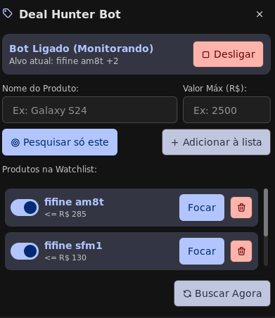

# 🏷️ Deals Hunter

<p align="center">
  <b>Cross-Platform Deal & Promotion Monitor with Native Desktop Notifications, Bar/System Tray Gadgets & Optional Telegram Bot</b><br>
  <i>Monitor de Promoções Multiplataforma com Notificações Direto no PC, Gadgets na Barra/Bandeja e Bot do Telegram Opcional</i>
</p>

<p align="center">
  <a href="#-português">🇧🇷 Português</a> •
  <a href="#-english">🇺🇸 English</a>
</p>

<p align="center">
  
</p>

---

## 🇧🇷 Português

**Deals Hunter** é um sistema aberto, modular e leve em Python (`asyncio`, `httpx`, `beautifulsoup4`, `sqlite3`, `pystray` e `tkinter`) para monitorar promoções na internet (atualmente com scrapers para **Pelando** e **Promobit**) em segundo plano, filtrando falsos positivos (cabos, espumas, acessórios) e disparando **notificações nativas direto no seu computador** — além de contar com integração opcional com **Bot do Telegram (@BotFather)**.

### ✨ Principais Recursos

- 🔔 **Notificações Direto no PC (Zero Configuração):** Funciona imediatamente após instalar (via `D-Bus / org.freedesktop.Notifications` e `notify-send` no Linux, Toast/Balloon nativo no Windows e `osascript` no macOS). Não exige criar bot no Telegram para usar!
- 🖥️ **Gadgets na Barra & System Tray Multiplataforma:**
  - **Windows 10/11, KDE Plasma, GNOME, XFCE, Cinnamon, MATE:** Ícone na Bandeja do Sistema (`--tray`) + Painel de Controle Gráfico escuro (`--gui`) para ligar/desligar o bot e escolher qual produto pesquisar.
  - **Waybar (Hyprland, Sway, Niri, River):** Módulo JSON pronto em `integrations/waybar/`.
  - **Noctalia Shell v5 (Niri / Hyprland):** Plugin nativo em Luau (`integrations/noctalia/deal-hunter/`) com ícone na barra e painel acoplado.
- 🛡️ **Filtro Anti-Falso Positivo Inteligente:**
  - Calcula piso mínimo automático (`min_price = 30% do max_price`) para ignorar cabos, cases e espumas baratas.
  - Filtra palavras obrigatórias (`must_contain`) e palavras negativas (`exclude_words`).
  - Banco SQLite (`watcher.db` em modo WAL) com tabela `seen_deals` para nunca repetir alertas.
- 🤖 **Bot do Telegram Opcional (@BotFather):** Para quem quiser também receber alertas no celular e controlar a lista remotamente via comandos (`/add`, `/list`, `/del`, `/check`, `/help`).

---

### 🚀 Instalação Rápida

#### 🐧 Linux (Arch, Ubuntu/Debian/Mint/Pop, Fedora, openSUSE, NixOS)
```bash
git clone https://github.com/Caspiom/Deals-Hunter.git
cd Deals-Hunter
chmod +x install.sh
./install.sh
```
O instalador detecta automaticamente sua distribuição e seu ambiente gráfico (**KDE, GNOME, XFCE, Waybar, Noctalia**), cria a `.venv`, ativa o serviço `deal-hunter.service` no `systemd --user` e cria os atalhos na barra/menu.

#### 🪟 Windows 10 / 11
1. Clone ou baixe o repositório.
2. Dê **duplo clique em `install.bat`** (ou execute `.\install.ps1` no PowerShell).
3. O instalador cria a `.venv`, configura o ícone na Bandeja do Windows (ao lado do relógio) sem janelas pretas de CMD, adiciona na inicialização do Windows e abre o Painel de Controle!

---

### 🎛️ Modos de Uso

| Comando | Descrição |
| :--- | :--- |
| `.venv/bin/python main.py --gui` | Abre o **Painel de Controle Gráfico** (Ligar/Desligar, escolher produto pesquisado, configurar alertas). |
| `.venv/bin/python main.py --tray` | Inicia o ícone na **Bandeja do Sistema (System Tray)** para Windows, KDE, GNOME, XFCE, etc. |
| `.venv/bin/python main.py` | Roda o daemon principal (Worker de Scraping + Listener Telegram opcional). |
| `.venv/bin/python main.py --check-now` | Força uma varredura imediata e envia notificações no PC (e Telegram, se ativo). |
| `.venv/bin/python main.py --dry-run` | Testa os scrapers no terminal sem salvar no histórico nem enviar notificações. |

---

### 🤖 Configurando o Telegram (Opcional — via @BotFather)

Se desejar controlar e receber alertas também pelo Telegram:
1. No Telegram, converse com o **[@BotFather](https://t.me/BotFather)**, envie `/newbot` e copie o **Token HTTP API**.
2. Abra o Painel Gráfico (`main.py --gui`), cole o **Bot Token** no campo correspondente e clique em **Salvar Configurações** (ou edite o arquivo `.env`).
3. Envie `/start` para o seu novo bot no Telegram — o **Deals Hunter** detectará e salvará seu `ALLOWED_CHAT_ID` pessoal automaticamente!

---
---

## 🇺🇸 English

**Deals Hunter** is an open-source, modular, and lightweight Python application (`asyncio`, `httpx`, `beautifulsoup4`, `sqlite3`, `pystray`, `tkinter`) that monitors online deal communities (**Pelando** and **Promobit**, easily extensible via `DealProvider`) in the background. It filters out false positives (cheap cables, cases, accessories) and sends **native Desktop Notifications directly to your PC**, with an **optional Telegram Bot (@BotFather)** integration as a secondary channel.

### ✨ Key Features

- 🔔 **Native PC Desktop Notifications (Zero Config Required):** Works out-of-the-box using `D-Bus (org.freedesktop.Notifications)` / `notify-send` on Linux, native PowerShell Toast/Balloon notifications on Windows, and `osascript` on macOS.
- 🖥️ **Cross-Platform Bar & System Tray Integrations:**
  - **Windows 10/11, KDE Plasma, GNOME, XFCE, Cinnamon, MATE:** Universal System Tray icon (`--tray`) + dark-themed Graphical Control Panel (`--gui`) to start/stop the bot and choose which product to monitor.
  - **Waybar (Hyprland, Sway, Niri):** Ready-to-use custom JSON module in `integrations/waybar/`.
  - **Noctalia Shell v5 (Niri / Hyprland):** Native Luau bar widget and attached popup panel in `integrations/noctalia/deal-hunter/`.
- 🛡️ **Smart Anti-False Positive Filtering:**
  - Automatically enforces a minimum price floor (`min_price = 30% of max_price`) to filter out accessories and replacement parts.
  - Supports mandatory keywords (`must_contain`) and negative keywords (`exclude_words`).
  - SQLite persistence (`watcher.db` in WAL mode) tracks `seen_deals` to prevent duplicate alerts.
- 🤖 **Optional Telegram Bot (@BotFather):** Manage your watchlist remotely from your phone (`/add`, `/list`, `/del`, `/check`, `/help`), locked down to your personal `ALLOWED_CHAT_ID`.

---

### 🚀 Quick Installation

#### 🐧 Linux (Arch, Ubuntu/Debian/Mint/Pop, Fedora, openSUSE, NixOS)
```bash
git clone https://github.com/Caspiom/Deals-Hunter.git
cd Deals-Hunter
chmod +x install.sh
./install.sh
```
The installer automatically detects your Linux distribution and Desktop Environment / Bar (**KDE, GNOME, XFCE, Waybar, Noctalia**), sets up the Python `.venv`, enables the `systemd --user` background service (`deal-hunter.service`), and installs desktop/bar shortcuts.

#### 🪟 Windows 10 / 11
1. Clone or download this repository.
2. **Double-click `install.bat`** (or run `.\install.ps1` in PowerShell).
3. The installer creates the `.venv`, sets up silent background launchers (`pythonw.exe` via VBS so no console window stays open), adds a shortcut to Windows Startup and Desktop, and launches the System Tray icon!

---

### 🧩 Architecture Overview

- `main.py` — Asyncio orchestrator running the background scraper worker (with 10–15 min random jitter) and optional Telegram polling listener.
- `notifier.py` — Cross-platform native PC desktop notification dispatcher (Linux D-Bus/`gdbus`/`notify-send`, Windows `.NET NotifyIcon`, macOS `osascript`).
- `gui.py` — Dark-themed Tkinter Control Panel to toggle the bot, pick the active searched product, manage the watchlist, and optionally configure Telegram.
- `tray.py` — Universal System Tray icon (`pystray` + `Pillow`) for Windows and Linux Desktop Environments.
- `scrapers.py` — Modular `DealProvider` interface with `PelandoProvider` and `PromobitProvider` + `validate_deal` anti-false positive filter.
- `db.py` — SQLite WAL persistence (`watchlist` and `seen_deals` tables).
- `bot.py` — Optional Telegram Bot long-polling listener and Markdown notification formatter.
- `ctl.py` — Fast JSON CLI controller used by bar widgets (Noctalia / Waybar).

---

### 📄 License

Released under the [MIT License](LICENSE).
